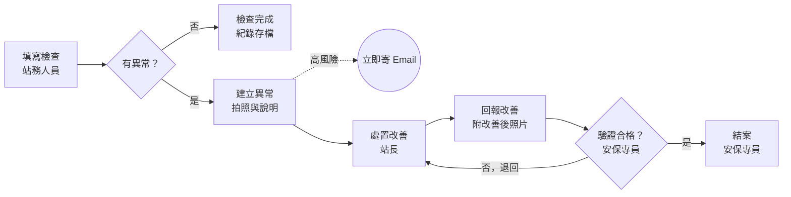
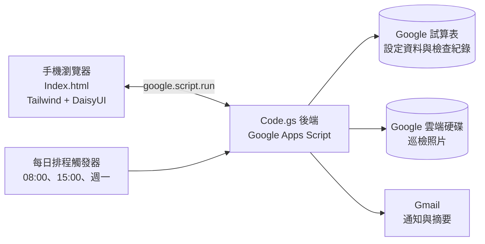

# 加油站自主檢查巡檢 App 系統規劃書

2026-11-02 · 林佳賢

## 專案目標與範圍

本系統讓約 50 個加油站以手機完成每日自主檢查，異常即時通報並追蹤到改善結案，取代紙本檢查表。

**要解決的問題**

- 紙本檢查表分散在各站，中區安保專員無法即時掌握各站狀況，稽核時才發現漏檢或造假。
- 發現異常後靠電話或 LINE 回報，沒有統一紀錄，改善進度難以追蹤。
- 檢查紀錄要人工彙整，月報與稽核佐證資料準備費時。

**範圍**

| 項目 | 本期納入 | 本期不納入 |
| --- | --- | --- |
| 對象 | 中區、南區直營加油站 | 物流倉儲（第二期再擴充） |
| 檢查類型 | 每日、每週、每月自主檢查 | 承攬商施工許可、教育訓練紀錄 |
| 功能 | 填報、拍照、異常追蹤、通知、報表 | 與公司 ERP 或人事系統串接 |
| 裝置 | 手機瀏覽器（可加到主畫面） | 原生 iOS／Android App |

**成功指標（建議值，待確認）**

- 各站每日檢查完成率達 95% 以上。
- 高風險異常 24 小時內有處置回覆，一般異常 7 天內結案。
- 月報可一鍵匯出，不再人工彙整。

## 參考的開源專案與借鏡重點

不直接沿用任何專案的程式碼，只借用設計概念，因此不受其授權條款限制。

| 專案 | 授權 | 借鏡重點 |
| --- | --- | --- |
| [microsoftarchive/microsoft-teams-apps-inspection](https://github.com/microsoftarchive/microsoft-teams-apps-inspection) | MIT | 檢查表模板與檢查項目分開管理；異常項目必須拍照 |
| [SafetyMP/Autonomous-EHS-Management](https://github.com/SafetyMP/Autonomous-EHS-Management) | Apache-2.0 | 異常到矯正預防措施（CAPA）結案驗證的狀態流程 |
| [DDDG637/enterprise-ehs-management](https://github.com/DDDG637/enterprise-ehs-management) | AGPL-3.0 | 隱患分級與限期改善欄位設計（只參考，不複製程式碼） |
| [amani-patrick/FEMS](https://github.com/amani-patrick/FEMS) | 未標示 | 滅火器等設備的到期日提醒 |
| [ManikantaGuptha29/SIF-Guard-AI](https://github.com/ManikantaGuptha29/SIF-Guard-AI) | 未標示 | 油品場站異常的嚴重度分級看板 |

**最重要的設計決定** 檢查項目放在試算表裡當資料管理，不寫死在程式中。日後法規或公司規定改變，只要改試算表，不用改程式。

## 使用者角色與權限

以 Google 帳號登入，系統依「人員」工作表的角色決定能看到哪些站、能做哪些事。

| 角色 | 主要使用者 | 可以做的事 | 看得到的範圍 |
| --- | --- | --- | --- |
| 站務人員 | 各站值班人員 | 填寫每日檢查、拍照回報異常 | 自己的站 |
| 站長 | 各站站長 | 填寫週檢、月檢；指派與回覆異常改善 | 自己的站 |
| 安保專員 | 中區、南區安保專員 | 執行 SL-H015 到站查核；驗證改善結果並結案；查看各站完成率與查核得分 | 負責區域內所有站 |
| 油品主管 | 各區油品主管經理（北區林鍇傑、中區張三友、南區劉信志） | 唯讀：查看總覽、缺失（異常）與查核紀錄，匯出 Excel；不能填寫或修改 | 負責區域內所有站 |
| 系統管理員 | 職安衛管理人員 | 維護檢查表模板、站點、人員；匯出報表 | 全部 |

**待確認** 站務人員是否每人都有公司 Google 帳號。若沒有，改用「站點共用帳號 + 填報人姓名欄位」。

## 檢查表設計

檢查表分每日、每週、每月三種頻率，每個項目只填「正常／異常／不適用」，選異常就必須拍照並寫說明。下表為初版草案，項目與法規依據需由你依公司現行自主檢查表確認。

| 頻率 | 類別 | 檢查項目 | 主要依據 | 風險等級 |
| --- | --- | --- | --- | --- |
| 每月 | 消防 | 滅火器在定位、壓力指針在綠區、無遮擋、無逾期 | 消防法、各類場所消防安全設備設置標準 | 高 |
| 每月 | 加油設備 | 加油機無漏油、油槍及軟管無破損、緊急遮斷閥、內部有無積水、防爆管線及防爆接線盒良好 | 加油站設置管理規則 | 高 |
| 每月 | 油槽 | 油槽人孔及卸油口蓋妥上鎖、周邊無油漬，壓力錶顥示狀態、陰井是否有漏油、氣或積水 | 公共危險物品及可燃性高壓氣體設置標準暨安全管理辦法 | 高 |
| 每月 | 環境 | 「嚴禁煙火」「加油請熄火」「不強迫加油」標示清楚，進出口標誌、標線清楚良好 | 加油站設置管理規則 | 中 |
| 每日 | 環境 | 地面無油漬、無積水、吸油棉與砂箱存量足夠 | 職業安全衛生設施規則 | 中 |
| 每月 | 電氣 | 配電箱關閉、無異常聲響或焦味 | 職業安全衛生設施規則 | 中 |
| 每週 | 環境 | 油水分離槽無溢流 | 水污染防治法 | 中 |
| 每月 | 消防 | 滅火器外觀、有效期限、壓力逐支點檢 | 消防安全設備檢修及申報辦法 | 高 |
| 每月 | 電氣 | 漏電斷路器按測試鈕可跳脫、接地線完整 | 職業安全衛生設施規則 | 高 |
| 每月 | 緊急應變 | 急救箱藥品齊全且未過期 | 職業安全衛生設施規則 | 低 |
| 每月 | 監控 | 監視器畫面清晰、錄影可回放 | 公司規定 | 低 |
| 每日 | 環境 | 其它危害 | 職業安全衛生設施規則 | 低 |

**風險等級的用途** 決定異常改善期限與通知對象，詳見「作業流程」與「通知與報表」兩節。

### 安保專員查核表（SL-H015）

除了站內自主檢查，系統再加一種「查核表」表單，給安保專員到站查核時使用，項目直接採用公司 SL-H015「加油站安全衛生管理及營運設備查核表」0601 版。

| 類別 | 項數 | 配分 |
| --- | --- | --- |
| 一、專業證照 | 4 | 8 |
| 二、安全衛生管理 | 6 | 12 |
| 三、安全衛生設施 | 13 | 27 |
| 四、營業設備 | 9 | 25 |
| 五、危害通識 | 3 | 6 |
| 六、消防管理 | 6 | 13 |
| 七、其他 | 1 | 5 |
| 「其他」自填欄位 | 4 | 4 |
| 合計 | 46 | 100 |

完整 42 項清單、項目代碼與法令規定見 SL-H015 查核項目

**兩種表單的差異**

| 項目 | 站內自主檢查 | 安保專員查核（SL-H015） |
| --- | --- | --- |
| 填寫人 | 站務人員、站長 | 安保專員 |
| 頻率 | 每日、每週、每月 | 每站每季一次（暫定） |
| 判定 | 正常／異常／不適用 | 符合／不符合／不適用；不適用項目從滿分扣除後換算成百分制 |
| 結果 | 異常進入異常追蹤 | 自動算出得分；不符合項目同樣進入異常追蹤 |
| 確認 | 填報人送出 | 站長在 App 按「確認查核結果」，取代紙本簽名，系統留下帳號與時間 |

**查核表的專屬設計**

- 專業證照、安全衛生管理、危害通識三類多為查閱文件，這些項目可上傳文件照片當佐證。
- 「其他」欄位保留原表做法：查核人自行填寫項目內容，每處 1 分。
- 原表 0525 版與 0601 版的差異：0601 版更新了法條條號，消防管理新增「緊急照明燈及避難指示燈測試」「防火避難設施與平面配置圖相符」兩項，並刪除單獨的「平面配置圖」「逃生路線圖」兩項。系統採用 0601 版。
- 日後查核表改版，只要在「檢查項目」工作表新增一個版本，舊紀錄仍依原版本計分，不受影響。

**計分方式** 不適用的項目不列入計算，以剩下的配分為滿分基準，再換算成 100 分制。

```latex
\text{查核得分} = \frac{\text{符合項目配分合計}}{100 - \text{不適用項目配分合計}} \times 100
```

例如某站沒有洗車機和離心機械（H015-C06、C12，共 4 分），滿分基準變成 96 分；符合項目合計 90 分時，查核得分為 90 ÷ 96 × 100 = 93.8 分（取小數一位）。

**不符合項目的風險等級** 依該項配分決定，改善期限沿用自主檢查的三級規則。

| 配分 | 風險等級 | 改善期限 | 項數 |
| --- | --- | --- | --- |
| 3 分以上 | 高 | 1 天 | 10 |
| 2 分 | 中 | 3 天 | 32 |
| 1 分（其他自填欄位） | 低 | 7 天 | 4 |

## 作業流程

每筆異常都要走完「通報、改善、驗證」三關才能結案，站長不能自己結案。



安保專員驗證不合格時退回站長重新改善，系統會記錄每次退回，避免異常被草草結案。

## 系統架構與技術選型

採用與職災追蹤系統相同的 Google Apps Script 架構（Code.gs + Index.html），免費、免架伺服器，公司既有的 Google Workspace 帳號就能用。



手機端只跟 Code.gs 溝通，所有權限檢查都在後端做，站務人員不需要試算表的編輯權限。

**已知限制** Apps Script 每天寄信上限約 1,500 封（Workspace 帳號），50 站的通知量遠低於此；另外單次執行最長 6 分鐘，月報匯出需分批處理。

## 資料表結構設計

所有資料存在一個 Google 試算表，分成 6 個工作表；前 3 個是設定資料，後 3 個是系統自動寫入的紀錄。

| 工作表 | 用途 | 主要欄位 |
| --- | --- | --- |
| 站點 Stations | 加油站基本資料 | 站點代碼、站名、區域（中區／南區）、地址、站長 Email、啟用 |
| 人員 Users | 登入帳號與權限 | Email、姓名、角色、所屬站點代碼、負責區域、啟用 |
| 檢查項目 Items | 檢查表模板 | 項目代碼、表單類型（自主檢查／SL-H015 查核表）、版本、頻率、類別、檢查內容、判定標準、法規依據、風險等級、配分、排序、啟用 |
| 檢查紀錄 Inspections | 每次檢查的表頭 | 紀錄編號、表單類型、版本、站點代碼、頻率、檢查日期、填報人、送出時間、異常數、得分、站長確認時間 |
| 檢查明細 Results | 每個項目的結果 | 紀錄編號、項目代碼、結果（自主檢查：正常／異常／不適用；查核表：符合／不符合／不適用）、得分、說明、照片連結 |
| 異常追蹤 Issues | 異常改善流程 | 異常編號、紀錄編號、項目代碼、風險等級、狀態、改善期限、處置說明、改善後照片、結案人、結案日期 |

**照片存放** 上傳到 Google 雲端硬碟「巡檢照片／站點代碼／年月」資料夾，試算表只存連結，避免試算表變得過大。

**改善期限自動計算** 高風險 1 天、中風險 3 天、低風險 7 天（建議值，可在設定中調整）。

## 畫面規劃

前端以手機直式畫面為主，視覺沿用職災追蹤系統的 Tailwind CSS + DaisyUI + Lucide Icons，主色改用代表安全的綠色搭配 Slate 灰，異常一律用紅色標示。

| 畫面 | 使用者 | 內容 |
| --- | --- | --- |
| 首頁 | 全部 | 今日待辦（今天還沒做的檢查）、我的站未結案異常數 |
| 填寫檢查 | 站務人員、站長 | 依類別分段的檢查項目卡片，每項三個大按鈕（正常／異常／不適用）；選異常展開拍照與說明欄；底部顯示完成進度 |
| 異常清單 | 站長、安保專員 | 依狀態分頁（待處理／改善中／待驗證／已結案），逾期項目置頂並標紅 |
| 異常詳情 | 站長、安保專員 | 異常照片與改善後照片並排對照、處置紀錄時間軸、結案或退回按鈕 |
| 區域總覽 | 安保專員 | 各站今日完成狀態燈號（綠：已完成、黃：部分、紅：未做）、本月完成率排行 |
| 管理設定 | 系統管理員 | 在 App 內新增、修改、停用站點、人員與檢查項目，不需開啟試算表 |

**手機使用重點**

- 按鈕夠大，戴手套也點得到。
- 拍照直接呼叫手機相機，上傳前自動壓縮成 1280 像素寬，節省流量。
- 檢查做到一半離開，再回來時保留已填內容（存在手機瀏覽器）。
- 可「加到主畫面」，像 App 一樣開啟。

## 通知與報表

通知用 Gmail 寄送（與職災追蹤系統相同做法），由每日排程觸發器自動執行，不需人工操作。

| 通知 | 觸發時機 | 收件人 |
| --- | --- | --- |
| 高風險異常 | 送出檢查時立即寄出 | 站長、區域安保專員 |
| 未完成每日檢查提醒 | 每天下午 3 點仍未送出 | 該站站長 |
| 異常逾期 | 每天早上 8 點檢查，超過改善期限 | 站長、區域安保專員 |
| 待驗證 | 站長回報改善完成時 | 區域安保專員 |
| 每週摘要 | 每週一早上 | 安保專員、系統管理員 |

**報表**

- **月報**：各站檢查完成率、異常件數（依類別、風險等級）、平均結案天數、逾期件數，可匯出 PDF 或 Excel。
- **稽核佐證**：指定站點與期間，匯出該期間所有檢查紀錄與照片連結，供內部稽核或 ISO 稽核使用。
- **常見異常排行**：找出各站重複發生的異常項目，作為教育訓練或設備汰換的依據。

日後可將月報數字接到「山隆通運職安衛百寶箱」的 KPI 儀表板。

## 開發分階段計畫

分四個階段，每階段完成後先在 2 至 3 個試點站實際使用，確認沒問題再進下一階段。

1. 第一階段：每日檢查上線
   - 建立試算表 6 個工作表與初版檢查項目。
   - 完成登入、首頁、填寫檢查、拍照上傳，以及管理設定畫面（新增站點、人員、檢查項目）。
   - 驗收：試點站能在 5 分鐘內完成每日檢查。
2. 第二階段：異常追蹤
   - 異常清單、異常詳情、改善回報、驗證結案。
   - 高風險異常即時通知。
   - 驗收：一筆異常從通報到結案全程可追蹤。
3. 第三階段：週檢、月檢與排程通知
   - 加入每週、每月檢查，以及 SL-H015 安保專員查核表（含配分計算、站長確認）。
   - 未完成提醒、逾期通知、每週摘要。
   - 區域總覽畫面。
4. 第四階段：報表與全面推廣
   - 月報、稽核佐證匯出、常見異常排行。
   - 推廣到中區、南區全部加油站，並製作操作說明。

**程式碼管理** 放在 GitHub 私人儲存庫做版本控管，做法與職災追蹤系統相同。

## 待你確認的事項

- [x] 檢查項目是否以公司現行的自主檢查表為準？可提供現行表單讓我轉成「檢查項目」工作表。
- [x] 站務人員是否每人都有公司 Google 帳號？
- [x] 改善期限（高 1 天、中 3 天、低 7 天）是否符合公司規定？
- [x] 試點站要選哪 2 至 3 站？

**SL-H015 查核表新增的待確認事項**

- [x] 安保專員到站查核的頻率：每站每月一次、每季一次，或依其他排程？決定：暫定每季一次。
- [x] 「不適用」項目（例如站內沒有洗車機、離心機械）如何計分：視同得分，或從滿分扣除後換算成百分制？決定：扣除後換算成百分制。
- [x] 查核表沒有風險等級，不符合項目的改善期限要沿用高／中／低三級，或依配分另訂（例如 3 分以上視為高風險）？決定：依配分，3 分以上高、2 分中、1 分低。
